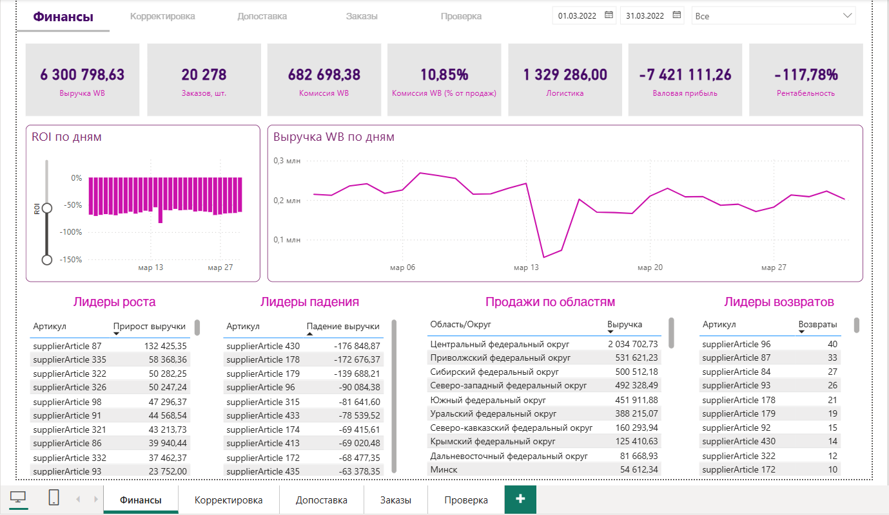
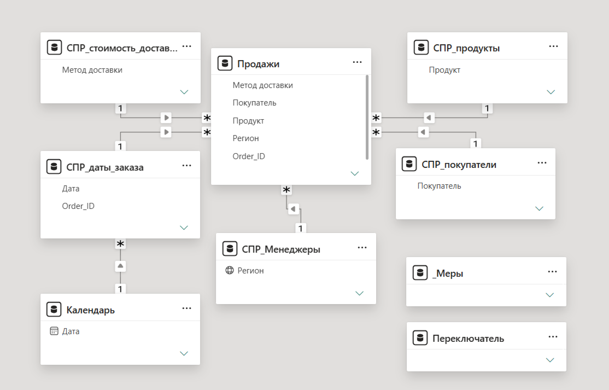

# 📊 Проекты по аналитике данных

## 1. Финансовая и продуктовая аналитика продаж на Wildberries (Power BI)

📂 **Файл отчёта:** [Скачать wb_analytics_pulman.pbix](https://github.com/VictoriaPulman/projects/raw/refs/heads/main/wb_analytics_pulman.pbix
)

Дашборд в **Microsoft Power BI** для анализа юнит-экономики, выручки, удержаний маркетплейса, возвратов и динамики продаж по артикулам и регионам.

### 🎯 Задача проекта
Заменить ручную сводку разрозненных отчётов Wildberries в Excel на единый автоматизированный инструмент для собственника и руководителя направления маркетплейсов, позволяющий в режиме одного окна:
* контролировать чистую выручку, комиссию WB, затраты на логистику, валовую прибыль и рентабельность;
* отслеживать ежедневную динамику продаж и ROI;
* оперативно выявлять убыточные артикулы, лидеров роста/падения и товары с высоким процентом возвратов.

### 🛠 Стек и архитектура решения
* **Источники и ETL (Power Query):** объединены выгрузки из базы данных **PostgreSQL** (отчёты реализации `SalesReport`, заказы, продажи, остатки, поставки) и справочники из **Google Таблиц** (себестоимость, тарифы, номенклатура). Выполнена очистка и нормализация ключей (`barcode`), приведение типов данных, устранение дубликатов, генерация составного ключа для записей с пустым штрихкодом без потери строк и построение динамической таблицы `Календарь`.
* **Бизнес-расчёты (DAX):** разработано **11 мер** по формулам заказчика с разделением операций по типам документов (`Продажа` / `Возврат`), построчным расчётом затрат через итератор `SUMX` (себестоимость, логистика, комиссия, вознаграждения WB, налог 2%) и динамическим сравнением выбранного периода с предыдущим аналогичным (`DATEADD` / `DATEDIFF`).
* **Визуализация:** 7 сводных KPI-карточек, графики динамики по дням, рейтинговые таблицы и фильтры по дате и артикулу (`supplierArticle`).

### ❄️ Модель данных («Снежинка»)
Спроектирована чистая архитектура модели данных (4 справочника и 5 таблиц фактов) с **0 двунаправленных связей**. Все связи настроены как однонаправленные (`1:*`) от таблиц измерений к таблицам фактов, что исключает конфликты фильтрации и гарантирует корректную работу вычислений DAX.

### 💡 Ключевые выводы по данным (на примере среза за март 2022)
* **Сводные показатели периода:** выручка WB составила **6,30 млн ₽** (20 278 заказов), комиссия маркетплейса — **682,7 тыс. ₽** (10,85% от продаж), расходы на логистику — **1,33 млн ₽**.
* **Причина валового убытка (-7,42 млн ₽, рентабельность -117,78%):** ряд позиций реализовывался со скидками ниже закупочной себестоимости, что при учёте расходов на логистику и комиссию уводило операционный результат в минус.
* **Точечная аналитика по артикулам и географии:**
  * лидеры роста выручки: `supplierArticle 87` (**+132,4 тыс. ₽**), `supplierArticle 335` (**+58,4 тыс. ₽**);
  * позиции с наибольшим падением: `supplierArticle 430` (**-176,8 тыс. ₽**), `supplierArticle 178` (**-172,7 тыс. ₽**);
  * лидеры по возвратам: `supplierArticle 96` (40 возвратов), `supplierArticle 87` (33 возврата);
  * ключевой регион продаж: Центральный федеральный округ (**2,03 млн ₽**).

---

## 2. Комплексная аналитика продаж, ABC-анализ ассортимента и оценка менеджеров (Power BI)

📂 **Файл отчёта:** [Скачать sales_analytics_pulman.pbix](https://github.com/VictoriaPulman/projects/raw/refs/heads/main/sales_analytics_pulman.pbix

Одностраничный управленческий дашборд в **Microsoft Power BI** для анализа выручки, рентабельности, клиентских сегментов, ABC-структуры ассортимента и убыточных сделок по менеджерам.

### 🎯 Задача проекта
Создать интерактивный отчёт для руководителя отдела продаж, позволяющий в режиме одного окна отслеживать ключевые показатели бизнеса, переключаться между метриками на лету, оценивать вклад товарных групп в прибыль и логистику, а также контролировать убыточные заказы.

### 🛠 Стек и архитектура решения
* **Подготовка данных и модель (Power Query):** подключена выгрузка заказов (`Продажи`) и справочники (`СПР_продукты`, `СПР_покупатели`, `СПР_Менеджеры`, `СПР_даты_заказа`, `СПР_стоимость_доставки`), создана динамическая таблица `Календарь`. Устранены дубликаты покупателей по ФИО с сохранением первичного сегмента (отражено в примечании на дашборде).
* **Расчёты и интерактивность (DAX):** создана отдельная таблица `_Меры` (`Выручка`, `Прибыль`, `Рентабельность`, `АКБ`, `Средний чек`, `Затраты на логистику`). Реализован **динамический переключатель метрик** через таблицу `Переключатель` и функцию `SWITCH`, перестраивающий графики листа в один клик. Выполнен **ABC-анализ** номенклатуры на группы `A`, `B` и `C`.
* **Визуализация:** срез по дате (`01.01.2022 – 29.04.2022`), 6 карточек KPI, динамика показателей по месяцам со средней линией, структура по сегментам покупателей, иерархический рейтинг номенклатуры с `drill-down`, географическая карта, сводная таблица ABC-анализа и детализация убыточных заказов по менеджерам.

### ❄️ Модель данных («Снежинка»)
Спроектирована модель данных с однонаправленными связями `1:*` от справочников (включая связку `Календарь ➔ СПР_даты_заказа ➔ Продажи`) и вынесенными служебными таблицами `_Меры` и `Переключатель`.

### 💡 Ключевые выводы по данным (01.01.2022 — 29.04.2022)
* **Общие показатели бизнеса:** выручка составила **1,10 млн ₽** (1 103 256,31), прибыль — **253,78 тыс. ₽** при рентабельности **23,00%**, активная клиентская база (АКБ) — **173 покупателя**, средний чек — **1,93 тыс. ₽**, затраты на логистику — **4 405**. Пик выручки пришёлся на март (**0,36 млн ₽**).
* **Структура клиентской базы:** основной объём выручки приносит корпоративный сегмент (`Corporate` — **70,78%**) и розничные покупатели (`Consumer` — **18,05%**).
* **Ассортимент и ABC-анализ:** локомотивом продаж выступают категории `Telephones and...` (**0,26 млн ₽**) и `Copiers and Fax` (**0,16 млн ₽**). Товары **группы A** приносят **771,90 тыс. ₽** выручки (~70%) и **143,54 тыс. ₽** прибыли при минимальных затратах на логистику (**930**), тогда как **группа C** генерирует более половины всех логистических расходов (**2 370 из 4 405**) при низкой прибыли.
* **Зона потерь по менеджерам:** выявлено **277 убыточных заказов**, принёсших суммарный убыток **-51 604,59 ₽** (наибольшие потери зафиксированы у менеджеров Мерингольд Ванесса — **-15 486,69 ₽** по 84 заказам и Семейкин Владислав — **-14 719,18 ₽** по 64 заказам).

