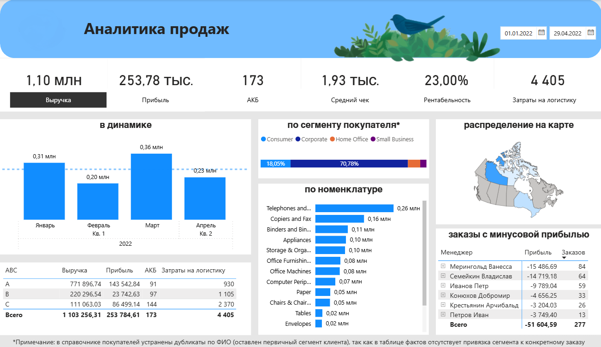
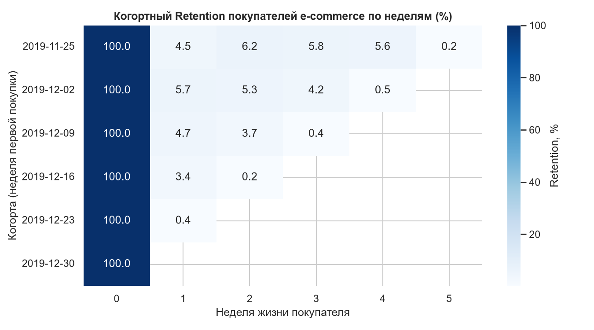
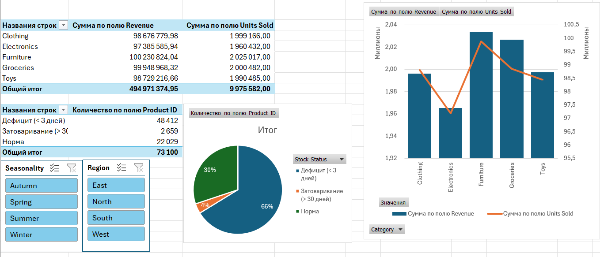

# 📊 Проекты по аналитике данных

## 1. Финансовая и продуктовая аналитика продаж на Wildberries (Power BI)

📂 **Файл отчёта:** [Скачать wb_analytics_pulman.pbix](https://github.com/VictoriaPulman/projects/raw/refs/heads/main/wb_analytics_pulman.pbix
)

Дашборд в **Microsoft Power BI** для анализа юнит-экономики, выручки, удержаний маркетплейса, возвратов и динамики продаж по артикулам и регионам.

### 🎯 Задача проекта
Заменить ручную сводку разрозненных отчётов Wildberries в Excel на единый автоматизированный инструмент для собственника и руководителя направления маркетплейсов, позволяющий в режиме одного окна:
* контролировать чистую выручку, комиссию WB, затраты на логистику, валовую прибыль и рентабельность;
* отслеживать ежедневную динамику продаж и ROI;
* оперативно выявлять убыточные артикулы, лидеров роста/падения и товары с высоким процентом возвратов.

### 🛠 Стек и архитектура решения
* **Источники и ETL (Power Query):** объединены выгрузки из базы данных **PostgreSQL** (отчёты реализации `SalesReport`, заказы, продажи, остатки, поставки) и справочники из **Google Таблиц** (себестоимость, тарифы, номенклатура). Выполнена очистка и нормализация ключей (`barcode`), приведение типов данных, устранение дубликатов, генерация составного ключа для записей с пустым штрихкодом без потери строк и построение динамической таблицы `Календарь`.
* **Бизнес-расчёты (DAX):** разработано **11 мер** по формулам заказчика с разделением операций по типам документов (`Продажа` / `Возврат`), построчным расчётом затрат через итератор `SUMX` (себестоимость, логистика, комиссия, вознаграждения WB, налог 2%) и динамическим сравнением выбранного периода с предыдущим аналогичным (`DATEADD` / `DATEDIFF`).
* **Визуализация:** 7 сводных KPI-карточек, графики динамики по дням, рейтинговые таблицы и фильтры по дате и артикулу (`supplierArticle`).

### ❄️ Модель данных («Снежинка»)
Спроектирована чистая архитектура модели данных (4 справочника и 5 таблиц фактов) с **0 двунаправленных связей**. Все связи настроены как однонаправленные (`1:*`) от таблиц измерений к таблицам фактов, что исключает конфликты фильтрации и гарантирует корректную работу вычислений DAX.

### 💡 Ключевые выводы по данным (на примере среза за март 2022)
* **Сводные показатели периода:** выручка WB составила **6,30 млн ₽** (20 278 заказов), комиссия маркетплейса — **682,7 тыс. ₽** (10,85% от продаж), расходы на логистику — **1,33 млн ₽**.
* **Причина валового убытка (-7,42 млн ₽, рентабельность -117,78%):** ряд позиций реализовывался со скидками ниже закупочной себестоимости, что при учёте расходов на логистику и комиссию уводило операционный результат в минус.
* **Точечная аналитика по артикулам и географии:**
  * лидеры роста выручки: `supplierArticle 87` (**+132,4 тыс. ₽**), `supplierArticle 335` (**+58,4 тыс. ₽**);
  * позиции с наибольшим падением: `supplierArticle 430` (**-176,8 тыс. ₽**), `supplierArticle 178` (**-172,7 тыс. ₽**);
  * лидеры по возвратам: `supplierArticle 96` (40 возвратов), `supplierArticle 87` (33 возврата);
  * ключевой регион продаж: Центральный федеральный округ (**2,03 млн ₽**).

---

## 2. Комплексная аналитика продаж, ABC-анализ ассортимента и оценка менеджеров (Power BI)

📂 **Файл отчёта:** [Скачать sales_analytics_pulman.pbix](https://github.com/VictoriaPulman/projects/raw/refs/heads/main/sales_analytics_pulman.pbix)

Одностраничный управленческий дашборд в **Microsoft Power BI** для анализа выручки, рентабельности, клиентских сегментов, ABC-структуры ассортимента и убыточных сделок по менеджерам.

### 🎯 Задача проекта
Создать интерактивный отчёт для руководителя отдела продаж, позволяющий в режиме одного окна отслеживать ключевые показатели бизнеса, переключаться между метриками на лету, оценивать вклад товарных групп в прибыль и логистику, а также контролировать убыточные заказы.

### 🛠 Стек и архитектура решения
* **Подготовка данных и модель (Power Query):** подключена выгрузка заказов (`Продажи`) и справочники (`СПР_продукты`, `СПР_покупатели`, `СПР_Менеджеры`, `СПР_даты_заказа`, `СПР_стоимость_доставки`), создана динамическая таблица `Календарь`. Устранены дубликаты покупателей по ФИО с сохранением первичного сегмента (отражено в примечании на дашборде).
* **Расчёты и интерактивность (DAX):** создана отдельная таблица `_Меры` (`Выручка`, `Прибыль`, `Рентабельность`, `АКБ`, `Средний чек`, `Затраты на логистику`). Реализован **динамический переключатель метрик** через таблицу `Переключатель` и функцию `SWITCH`, перестраивающий графики листа в один клик. Выполнен **ABC-анализ** номенклатуры на группы `A`, `B` и `C`.
* **Визуализация:** срез по дате (`01.01.2022 – 29.04.2022`), 6 карточек KPI, динамика показателей по месяцам со средней линией, структура по сегментам покупателей, иерархический рейтинг номенклатуры с `drill-down`, географическая карта, сводная таблица ABC-анализа и детализация убыточных заказов по менеджерам.

### ❄️ Модель данных («Снежинка»)
Спроектирована модель данных с однонаправленными связями `1:*` от справочников (включая связку `Календарь ➔ СПР_даты_заказа ➔ Продажи`) и вынесенными служебными таблицами `_Меры` и `Переключатель`.

### 💡 Ключевые выводы по данным (01.01.2022 — 29.04.2022)
* **Общие показатели бизнеса:** выручка составила **1,10 млн ₽** (1 103 256,31), прибыль — **253,78 тыс. ₽** при рентабельности **23,00%**, активная клиентская база (АКБ) — **173 покупателя**, средний чек — **1,93 тыс. ₽**, затраты на логистику — **4 405**. Пик выручки пришёлся на март (**0,36 млн ₽**).
* **Структура клиентской базы:** основной объём выручки приносит корпоративный сегмент (`Corporate` — **70,78%**) и розничные покупатели (`Consumer` — **18,05%**).
* **Ассортимент и ABC-анализ:** локомотивом продаж выступают категории `Telephones and...` (**0,26 млн ₽**) и `Copiers and Fax` (**0,16 млн ₽**). Товары **группы A** приносят **771,90 тыс. ₽** выручки (~70%) и **143,54 тыс. ₽** прибыли при минимальных затратах на логистику (**930**), тогда как **группа C** генерирует более половины всех логистических расходов (**2 370 из 4 405**) при низкой прибыли.
* **Зона потерь по менеджерам:** выявлено **277 убыточных заказов**, принёсших суммарный убыток **-51 604,59 ₽** (наибольшие потери зафиксированы у менеджеров Мерингольд Ванесса — **-15 486,69 ₽** по 84 заказам и Семейкин Владислав — **-14 719,18 ₽** по 64 заказам).

---

## 3. Продуктовый анализ e-commerce: воронка, когортный Retention и проверка гипотез (SQL + Python)

📂 **Файлы проекта:** [Скачать cosmetics_queries.sql](https://github.com/VictoriaPulman/projects/raw/refs/heads/main/queries.sql) • [Скачать product_analysis.ipynb](https://github.com/VictoriaPulman/projects/raw/refs/heads/main/product_analysis.ipynb)

📌 **Источник данных:** открытый датасет с платформы **Kaggle** — *eCommerce Events History in Cosmetics Shop* (автор: **Michael Kechinov**), срез за **декабрь 2019 года** (`2019-Dec.csv`).

Продуктовое исследование поведения **357 801 уникального пользователя** (более **3,5 млн событий** кликстрима интернет-магазина косметики за декабрь 2019 г.): анализ воронки конверсий, сегментация по ценовым категориям и брендам, когортный анализ удержания по неделям и статистическая проверка гипотезы о среднем чеке.

### 🎯 Задача проекта
Найти точки потери конверсии на пути пользователя от просмотра карточки товара до оплаты, выявить бренды с аномально высокой долей отказов из корзины, оценить возвращаемость покупателей и проверить, как наличие известного бренда влияет на средний чек заказа.

### 🛠 Стек и методика анализа
* **SQL (PostgreSQL / DBeaver):** очистка логов (`price > 0`), построение сквозной воронки с помощью `CTE` и оконных функций (`MAX() OVER ()`), сегментация на масс-маркет (`< $10`) и премиум (`>= $10`), расчёт доли удалений из корзины по ТОП-10 брендам.
* **Python (VS Code / pandas, seaborn, scipy):** построение матрицы недельного когортного удержания (`Cohort Retention Heatmap`) и проверка статистической значимости различий медианного чека (`AOV`) непараметрическим критерием **Манна-Уитни** (из-за скошенности распределения чеков).

### 📊 Результаты расчётов (SQL)

#### 1. Воронка конверсий по уникальным пользователям

| Этап воронки | Уникальные пользователи | Всего событий | Конверсия от просмотра (%) |
| :--- | :---: | :---: | :---: |
| Просмотр товара (`view`) | 357 801 | 1 722 264 | 100,00% |
| Добавление в корзину (`cart`) | 83 435 | 925 917 | 23,32% |
| Удаление из корзины (`remove_from_cart`) | 45 207 | 664 340 | 12,63% |
| Покупка (`purchase`) | 25 613 | 213 158 | 7,16% |

#### 2. Сравнение воронки по ценовым сегментам

| Ценовой сегмент | Просмотры (чел.) | Корзина (чел.) | Покупки (чел.) | Конверсия в покупку (%) |
| :--- | :---: | :---: | :---: | :---: |
| Масс-маркет (`< $10`) | 254 088 | 72 763 | 22 571 | 8,88% |
| Премиум (`>= $10`) | 159 185 | 34 277 | 12 331 | 7,75% |

#### 3. ТОП-10 брендов по выручке и доле удалений из корзины

| Бренд | Сессий с корзиной | Сессий с удалением | Сессий с покупкой | Доля удалений из корзины (%) | Выручка ($) |
| :--- | :---: | :---: | :---: | :---: | :---: |
| **runail** | 28 463 | 15 891 | 7 992 | 55,83% | 58 176,80 |
| **grattol** | 14 785 | 8 509 | 3 842 | 57,55% | 43 791,90 |
| **irisk** | 20 962 | 11 501 | 6 232 | 54,87% | 35 291,50 |
| **uno** | 5 475 | 3 069 | 1 767 | 56,05% | 29 084,60 |
| **estel** | 7 236 | 3 643 | 2 104 | 50,35% | 24 474,00 |
| **jessnail** | 3 811 | 2 175 | 1 119 | 57,07% | 24 074,90 |
| **strong** | 513 | 284 | 115 | 55,36% | 22 266,40 |
| **masura** | 9 752 | 7 188 | 2 230 | 73,71% | 19 810,30 |
| **cnd** | 2 545 | 1 344 | 686 | 52,81% | 19 378,90 |
| **ingarden** | 8 362 | 5 296 | 2 391 | 63,33% | 18 938,30 |

### 💡 Ключевые продуктовые выводы и проверка гипотезы
* **Главное узкое горлышко — корзина:** из **83 435** пользователей, добавивших товар в корзину, **45 207 человек (54,2%)** удаляют позиции (`remove_from_cart`). Особого аудита карточек и остатков требуют бренды **masura** (доля удалений **73,71%**) и **ingarden** (**63,33%**), тогда как у **estel** (**50,35%**) и **cnd** (**52,81%**) конверсия корзины заметно стабильнее.
* **Парадокс ценовых сегментов:** в массовом сегменте (`< $10`) выше стартовая конверсия из просмотра в покупку (**8,88%** против **7,75%** у премиума), однако в премиум-сегменте (`>= $10`) покупатели реже бросают корзину — до оплаты доходят **35,97%** пользователей корзины против **31,02%** в масс-маркете.
* **Возвращаемость (Cohort Retention):** повторные заказы в течение первых 4 недель совершают **4,5–6,2%** покупателей первой когорты (`2019-11-25`) и **3,7–5,7%** покупателей второй когорты (`2019-12-02`) — это целевая аудитория для триггерных рассылок на 2-ю и 3-ю неделю после первого заказа (расходники для маникюра).
* **Проверка гипотезы AOV (Mann-Whitney U-test):** заказы, содержащие брендовые товары (`n = 25 240`), имеют статистически значимо более высокий чек по сравнению с заказами без бренда (`n = 3 654`): медиана **$27,93** против **$18,33** (**+52,4%**), среднее **$39,01** против **$25,49** (`p-value < 0,0001`). Продвижение брендированного ассортимента в рекомендациях напрямую увеличивает средний чек.

  ---

## 4. Операционный дашборд продаж, оборачиваемости и контроля складских остатков (Excel)

📂 **Файл отчёта:** [Скачать retail_store_inventory.xlsx](https://github.com/VictoriaPulman/projects/raw/refs/heads/main/retail_store_inventory.xlsx)

📌 **Источник данных:** открытый датасет с платформы **Kaggle** — *Retail Store Inventory Forecasting Dataset* (автор: **Anirudh Chauhan**, **73 100 записей** по магазинам, категориям, остаткам, продажам и ценам).

Интерактивный управленческий отчёт в **Microsoft Excel** для мониторинга выручки по категориям и регионам, расчёта оборачиваемости запасов в днях и выявления рисков дефицита (`Out-of-Stock`) и затоваривания на складе.

### 🎯 Задача проекта
Автоматизировать оценку товарных запасов и продаж по 5 категориям ритейла (`Furniture`, `Groceries`, `Clothing`, `Toys`, `Electronics`), разделив все складские позиции по уровням риска, и дать руководителю инструмент интерактивной фильтрации по регионам и сезонам.

### 🛠 Стек и методика расчётов
* **ETL и очистка (Power Query):** импорт CSV-выгрузки (73 100 строк) с корректным преобразованием десятичных разделителей, создание расчётных столбцов чистой выручки с учётом скидки (`Revenue`), потерь на скидках (`Discount Loss`) и оборачиваемости запасов в днях (`Days of Inventory`).
* **Классификация склада (формулы Excel):** с помощью вложенных логических функций (`ЕСЛИ` / `IF`) каждая позиция автоматически отнесена к одному из статусов: **«Дефицит (< 3 дней)»**, **«Норма (3–30 дней)»**, **«Затоваривание (> 30 дней)»** или **«Нет в наличии»**.
* **Визуализация и интерактивность:** сводные таблицы, комбинированная диаграмма (выручка и объём продаж на двух осях), круговая диаграмма структуры складских остатков и связанные **срезы (`Slicers`)** по сезонам (`Seasonality`) и регионам (`Region`).

### 📊 Ключевые показатели и выводы по данным
* **Общие показатели продаж:** совокупная выручка составила **$494 971 374,90** (~**$494,97 млн**) при общем объёме реализации **9 975 582 единицы** товара.
* **Выручка по категориям:** продажи распределены равномерно с небольшим лидерством категорий **Furniture** (**$100,23 млн**, 2,03 млн шт.) и **Groceries** (**$99,95 млн**, 2,00 млн шт.), далее идут **Toys** (**$98,73 млн**), **Clothing** (**$98,68 млн**) и **Electronics** (**$97,39 млн**).
* **Диагностика складских остатков:**
  * **Дефицит (`< 3 дней` запаса):** **48 412 записей (66%)** — ключевая точка потери выручки; требуется пересмотр страхового запаса и ускорение пополнения по ходовым позициям;
  * **Норма (`3–30 дней`):** **22 029 записей (30%)**;
  * **Затоваривание (`> 30 дней`):** **2 659 записей (4%)** — минимальная доля неликвидов, требующая точечных распродаж.

