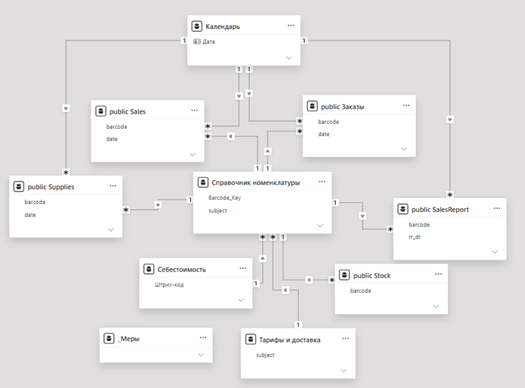

# Проекты по аналитике данных

## 1. Финансовая и продуктовая аналитика продаж на Wildberries (Power BI)

Файл отчёта: [Анализ_WB_ПУЛЬМАН.pbix](Анализ_WB_ПУЛЬМАН.pbix)

Дашборд в Power BI для анализа выручки, удержаний маркетплейса, возвратов, юнит-экономики и динамики продаж по артикулам и регионам.

### Что сделано
* **ETL (Power Query):** объединены выгрузки из PostgreSQL (отчёты реализации, заказы, продажи, остатки, поставки) и справочники из Google Таблиц (себестоимость, тарифы, номенклатура). Проведена очистка ключей (`barcode`), приведение типов, удаление дубликатов, создание составного ключа для записей без штрихкода и таблицы `Календарь`.
* **Модель данных:** схема «снежинка» (4 справочника и 5 таблиц фактов) с однонаправленными связями `1:*` и нулём двунаправленных связей.
* **Расчёты (DAX):** 11 мер с разделением операций (`Продажа` / `Возврат`), построчным расчётом затрат через `SUMX` (себестоимость, логистика, комиссия, вознаграждения WB, налог 2%) и сравнением с предыдущим периодом (`DATEADD` / `DATEDIFF`).
* **Визуализация:** 7 KPI-карточек, графики динамики по дням, рейтинговые таблицы и фильтры по дате и артикулу.

### Основные выводы по данным (на примере среза за март 2022)
* Выручка за период составила **6,30 млн ₽** (20 278 заказов), комиссия WB — **682,7 тыс. ₽** (10,85%), расходы на логистику — **1,33 млн ₽**.
* Валовый убыток составил **-7,42 млн ₽** (рентабельность **-117,78%**) из-за продажи ряда позиций со скидками ниже закупочной себестоимости.
* Выявлены лидеры роста (`supplierArticle 87`: **+132,4 тыс. ₽**), позиции с наибольшим падением (`supplierArticle 430`: **-176,8 тыс. ₽**), лидеры по возвратам (`supplierArticle 96`: 40 возвратов) и основной регион продаж — ЦФО (**2,03 млн ₽**).
